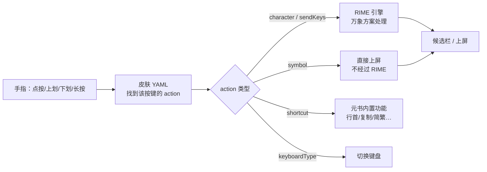
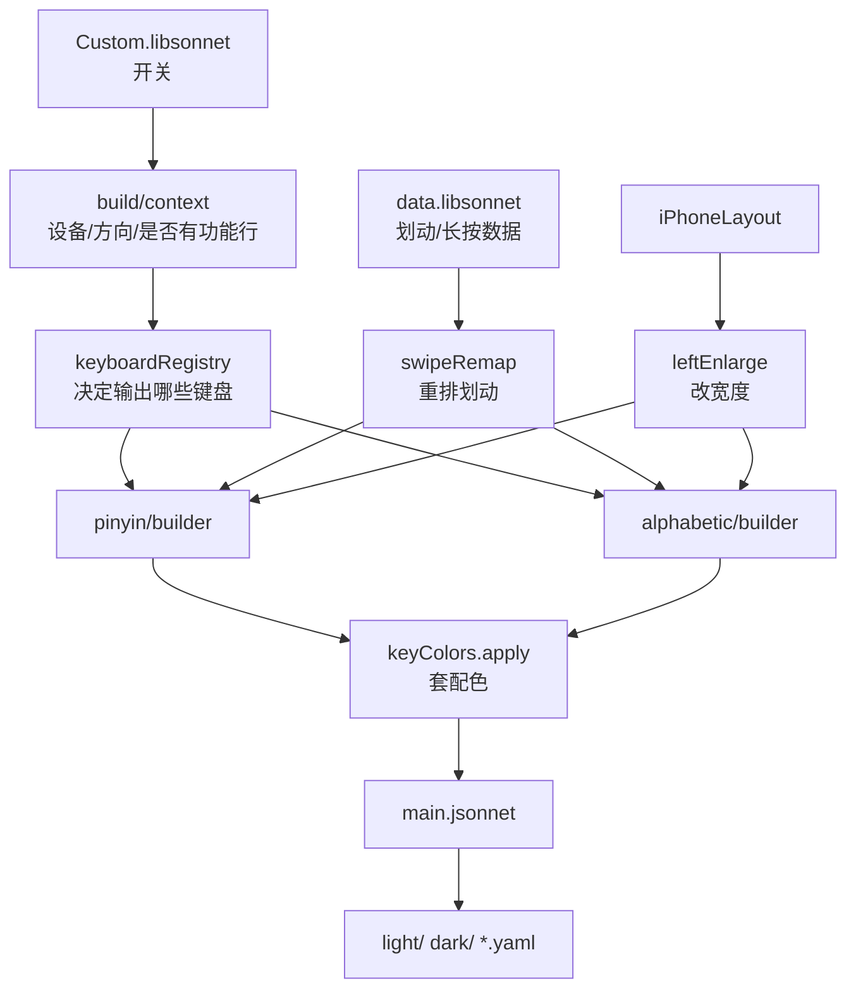
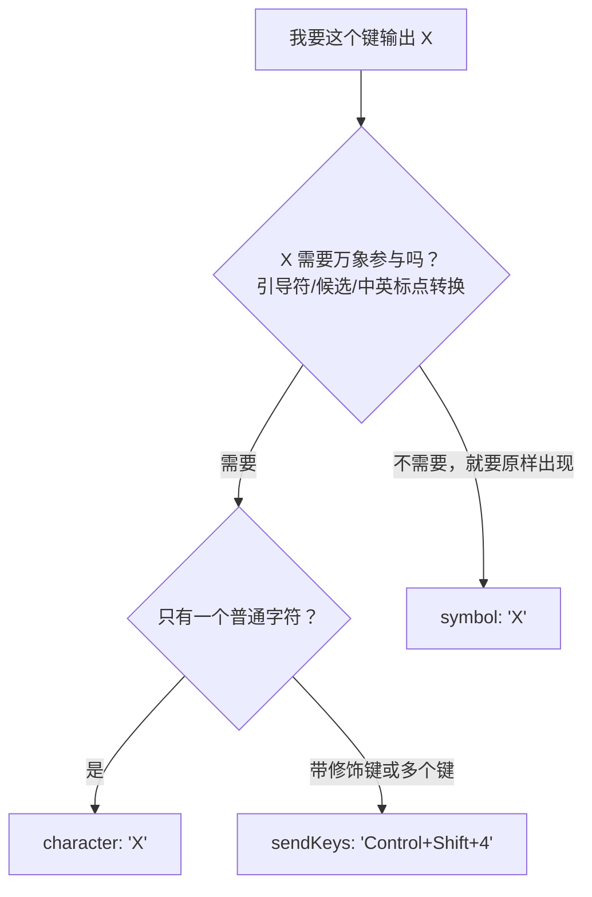

# WanxiangSkin 定制手册（anymore-hamster 分支）

> 适用组合：**元书输入法（Hamster3，iOS）+ 万象拼音 PRO（`wanxiang_pro`）+ 全拼 + 汉心辅助码**  
> 皮肤源码：`Skin_Keyboard/万象-元书/WanxiangSkin/jsonnet/`  
> 个人修改全部在 **`anymore-hamster`** 分支，`main` 保持原作者版本。

这份文档要讲清楚一件事：**按键上的每个功能是怎么一步步实现的**。看懂之后，你应该能自己改键位、改划动、改颜色、加功能。

---

## 目录

1. [总体原理：一次按键经过了哪些环节](#1-总体原理一次按键经过了哪些环节)
2. [YAML 与 Jsonnet 的关系](#2-yaml-与-jsonnet-的关系)
3. [项目结构与构建流程](#3-项目结构与构建流程)
4. [Jsonnet 速成（只讲本项目用到的）](#4-jsonnet-速成只讲本项目用到的)
5. [元书皮肤基础：布局、按键、样式](#5-元书皮肤基础布局按键样式)
6. [按键动作 action：最核心的知识](#6-按键动作-action最核心的知识)
7. [万象方案功能与按键的对应关系](#7-万象方案功能与按键的对应关系)
8. [通知机制：让按键随状态变化](#8-通知机制让按键随状态变化)
9. [本分支的定制功能说明](#9-本分支的定制功能说明)
10. [定制菜谱：常见需求怎么改](#10-定制菜谱常见需求怎么改)
11. [编译、检查与发布](#11-编译检查与发布)
12. [注意事项与踩坑清单](#12-注意事项与踩坑清单)
13. [参考资料](#13-参考资料)

---

## 1. 总体原理：一次按键经过了哪些环节



要记住三点：

- **皮肤只负责发出指令。** 按键本身不实现功能，它只说明"把什么交给谁去处理"。
- **功能有三个来源：**
  - 元书内置功能，比如 `shortcut`、`keyboardType`；
  - 万象方案定义的规则，比如引导符、`key_binder`、Lua 脚本；
  - 系统直接上屏，也就是 `symbol`。
- **同一个字符，交给谁结果就不同。** 比如 `/`：交给万象（`character`）会进入符号快打模式，直接上屏（`symbol`）就只是一个 `/`。

---

## 2. YAML 与 Jsonnet 的关系

- 元书**只识别 YAML** 格式的皮肤文件。Jsonnet 是可选的开发工具，最终要编译成 YAML。元书 App 内置了 Jsonnet 编译器。
- 本项目全部用 Jsonnet 编写。`main.jsonnet` 返回一个"输出路径 → YAML 文本"的对象，由它生成 `light/*.yaml` 和 `dark/*.yaml`。
- 为什么用 Jsonnet：中文键盘、英文键盘、浅色、深色、横屏、竖屏、iPhone、iPad 这些组合，共用同一套逻辑。**改一处，所有输出一起变。**

```text
Jsonnet 源码（你改的地方）  ──编译──▶  YAML（元书读取的地方，不要手改）
```

> ⚠️ 不要直接修改生成出来的 YAML，下次编译会被覆盖。

---

## 3. 项目结构与构建流程

```text
jsonnet/
├── Custom.libsonnet          # ★ 所有公开开关的唯一入口
├── main.jsonnet              # 按 浅/深 × 横/竖 渲染已注册键盘
├── build/                    # 输出配置、键盘注册、构建上下文
│   ├── skinConfig.libsonnet      # 生成 config.yaml 的键盘映射
│   ├── keyboardRegistry.libsonnet# 注册要输出的键盘
│   └── context.libsonnet         # 设备/方向/布局上下文，插入功能行
├── design/                   # 视觉：颜色、字号、偏移、样式工厂
│   ├── appearance.libsonnet      # 颜色/字号/高度
│   ├── keyPalette.libsonnet      # ★(本分支) 每键独立配色
│   └── keyColors.libsonnet       # ★(本分支) 把配色套到按键上
├── components/               # 公共组件：按键、系统键、功能行、工具栏、候选栏
└── keyboards/
    └── keyboard26/
        ├── base/
        │   ├── iPhoneLayout.libsonnet # 26 键行结构（中/英）
        │   ├── letters.libsonnet      # 字母键规格
        │   └── swipeRemap.libsonnet   # ★(本分支) 去功能行后的划动重排
        ├── pinyin/                    # 中文 26 键
        │   ├── data.libsonnet         # 长按菜单 + 上下划数据
        │   ├── builder.libsonnet      # 组装中文键盘
        │   └── leftEnlarge.libsonnet  # ★(本分支) 左侧按键放大
        └── alphabetic/                # 英文 26 键（data / builder / systemKeys）
```

一次构建的数据流向如下：



**按需求找文件的速查表：**

| 想改什么                                   | 改哪个文件                                                   |
| ------------------------------------------ | ------------------------------------------------------------ |
| 开关、工具栏按钮、123 键行为、Shift 预编辑 | `Custom.libsonnet`                                           |
| 某个字母键的上划、下划、长按               | `keyboards/keyboard26/pinyin/data.libsonnet`（英文是 `alphabetic/data.libsonnet`） |
| 关闭功能行后的划动重排                     | `keyboards/keyboard26/base/swipeRemap.libsonnet`             |
| 行结构、底行顺序                           | `keyboards/keyboard26/base/iPhoneLayout.libsonnet`           |
| 左侧键宽度                                 | `keyboards/keyboard26/pinyin/leftEnlarge.libsonnet`          |
| 单键颜色                                   | `design/keyPalette.libsonnet`                                |
| 全局颜色、字号、高度                       | `design/appearance.libsonnet`                                |
| 系统键（空格、回车、退格、中英）           | `components/systemKeys/`                                     |
| 工具栏按钮的定义                           | `components/toolbar/registry.libsonnet`                      |

---

## 4. Jsonnet 速成（只讲本项目用到的）

### 4.1 对象合并 `+`：右边覆盖左边

```jsonnet
{ a: 1, b: 2 } + { b: 3 }        // 结果 { a: 1, b: 3 }
```

本项目里大量使用这种写法。例如 `swipeUp + keepUp + { x: edit.tail }`，表示在原始上划数据上依次覆盖：后写的赢。

### 4.2 深层合并 `+:`：只改一个字段，保留其余

```jsonnet
local btn = { size: { width: 0.1 }, action: { character: 'h' } };
btn + { size+: { width: 0.12 } }  // action 保留，只改 width
btn + { size:  { width: 0.12 } }  // ⚠️ 整个 size 被替换
```

### 4.3 `local`、函数、`import`

```jsonnet
local palette = import '../../../design/keyPalette.libsonnet';
local double(x) = x * 2;
{ w: double(3) }                  // { w: 6 }
```

### 4.4 隐藏字段 `::`：不会输出到 YAML

```jsonnet
{
  enabled(context):: context.deviceType == 'iPhone',  // 工具函数，不出现在结果里
  visible: 1,
}
```

### 4.5 条件与可选字段

```jsonnet
{
  action: if settings.fix_sf_symbol then { character: 'a' } else { symbol: 'a' },
  [if hasDown then 'swipeDownAction']: { character: '|' },  // 条件成立才有这个键
}
```

### 4.6 常用标准库函数

```jsonnet
std.objectHas(obj, 'hButton')      // 对象有没有这个字段
std.member(['a', 'b'], 'a')        // 数组里有没有
[k + 'Button' for k in ['q', 'w']] // 列表推导 → ['qButton', 'wButton']
std.asciiUpper('a')                // 'A'
```

> 💡 键名里有特殊字符时要加引号，例如 `'123': '...'`、`';Button'`。

---

## 5. 元书皮肤基础：布局、按键、样式

### 5.1 `config.yaml`：决定每种情况下用哪个文件

```yaml
pinyin:
  phone:
    portrait: "pinyinPortrait"     # 浅色读 light/pinyinPortrait.yaml，深色读 dark/…
    landscape: "pinyinLandscape"
```

本项目的 `config.yaml` 由 `build/skinConfig.libsonnet` 生成。

### 5.2 布局：用 `HStack`（行）和 `VStack`（列）切分空间，`Cell` 放按键

```yaml
- HStack:
    subviews:
      - Cell: qButton
      - Cell: wButton
```

> ⚠️ **同一层级只能用同一种方式切分。** HStack 和 VStack 不能并列；Cell 和 HStack 也不能并列。

对应到 Jsonnet（`iPhoneLayout.libsonnet` 里的写法）：

```jsonnet
{ HStack: { subviews: [ { Cell: 'aButton' }, { Cell: 'sButton' } ] } }
```

### 5.3 按键对象的常用属性

| 属性                                  | 作用                                            |
| ------------------------------------- | ----------------------------------------------- |
| `size`                                | 按键尺寸，例如 `{ width: { percentage: 0.1 } }` |
| `bounds`                              | 可视区域，可以让按键"看起来小、点起来大"        |
| `backgroundStyle` / `foregroundStyle` | 背景和前景样式名（可以是数组，多层叠加）        |
| `action`                              | 点按动作                                        |
| `preeditStateAction`                  | 输入中（有未上屏编码）时的点按动作              |
| `swipeUpAction` / `swipeDownAction`   | 上划 / 下划动作                                 |
| `repeatAction`                        | 长按时重复执行的动作                            |
| `hintSymbolsStyle`                    | 长按菜单                                        |
| `notification`                        | 收到通知时切换成另一套样式和动作（见第 8 节）   |

### 5.4 样式按名字引用

样式不直接写在按键里，而是定义在文件顶层，按键通过名字引用它：

```yaml
hButton:
  backgroundStyle: alphabeticBackgroundStyle   # 引用名字
  foregroundStyle: [hButtonForegroundStyle, hButtonUpForegroundStyle]

alphabeticBackgroundStyle:                     # 在顶层定义
  buttonStyleType: geometry
  normalColor: FFFFFF
```

本项目的配色功能（第 9.4 节）利用的就是这一点：把 `alphabeticBackgroundStyle` 换成每个键各自的 `keyColor<键>BackgroundStyle`。

---

## 6. 按键动作 action：最核心的知识

### 6.1 动作类型总表（iOS 可用）

| 写法                                                      | 交给谁                           | 典型用途                         | 例子                                           |
| --------------------------------------------------------- | -------------------------------- | -------------------------------- | ---------------------------------------------- |
| `{ character: 'a' }`                                      | RIME（万象）                     | 字母、需要万象处理的符号         | `{ character: '/' }` 进入符号快打              |
| `{ symbol: '/' }`                                         | 系统，直接上屏                   | 只想出这个字符本身               | `{ symbol: '【' }`                             |
| `{ sendKeys: 'R' }`                                       | RIME，可以带修饰键、一次发多个键 | 触发万象引导符或快捷键           | `{ sendKeys: 'Control+Shift+4' }`              |
| `{ shortcut: '#行首' }`                                   | 元书内置                         | 编辑、切换、面板                 | `#copy`、`#简繁切换`、`#RimeSwitcher`          |
| `{ rimeOption: 'ascii_mode' }`                            | RIME 开关                        | **只有两个状态**的开关           | 见 12 节注意点                                 |
| `{ keyboardType: 'symbolic' }`                            | 元书                             | 切换键盘                         | `pinyin` / `alphabetic` / `numeric` / `emojis` |
| `{ switchRimeSchema: 'wanxiang_pro' }`                    | 元书                             | 切换方案                         | 建议用方案 ID                                  |
| `{ snippet: '{{date:yyyy-MM-dd}}' }`                      | 元书                             | 模板文本                         | 插入日期                                       |
| `{ openURL: '...' }`                                      | 元书                             | 打开链接或元书内文件             | 一键打开 `Custom.libsonnet`                    |
| `{ combine: [ ... ] }`                                    | 元书                             | 依次执行多个动作，可以夹 `delay` | 切键盘的同时切方案                             |
| `'space'`、`'tab'`、`'backspace'`、`'moveCursorBackward'` | 标准动作                         | 基础编辑                         | 写成字符串，不加花括号                         |

> ⚠️ `sendKeyEvent`、`switchInputMethod`、`#rimeDeploy` **只有 Android 支持**，iOS 上不会生效。

### 6.2 `character`、`symbol`、`sendKeys` 怎么选



**本项目里的真实例子（`pinyin/data.libsonnet`）：**

```jsonnet
f: { action: { symbol: '【' }, label: { text: '[' } },   // 直接上屏「【」
j: { action: { character: '/' }, label: { text: '/' } }, // 交给万象：进入符号快打
b: { action: { sendKeys: 'R' }, label: { ... } },        // 发大写 R：触发万象「金额大写」
```

### 6.3 `label`：角标显示什么

```jsonnet
{ action: {...}, label: { text: '繁' } }                       // 文字
{ action: {...}, label: { systemImageName: 'scissors' } }      // SF Symbol 图标
{ action: {...}, label: { text: '' } }                         // 空字符串＝隐藏角标
```

> 💡 有些 SF Symbol 在旧系统上显示不出来。打开 `Custom.libsonnet` 的 `fix_sf_symbol: true`，就会使用兼容性更好的图标。

---

## 7. 万象方案功能与按键的对应关系

以下内容来自你分支里的 `wanxiang_pro.schema.yaml`。如果你在 `wanxiang_pro.custom.yaml` 里改过，以改过的为准。

### 7.1 引导符和特殊按键速查

| 按键或编码                              | 万象中的作用                                                 | 皮肤上怎么触发                                         |
| --------------------------------------- | ------------------------------------------------------------ | ------------------------------------------------------ |
| `/` 开头                                | 符号快打（`punct` 规则），例如 `/sym…` 超级符号库、`/uuid`、`/tj` 输入统计 | `{ character: '/' }`                                   |
| 单独打 `/`                              | 被当作引导符；`key_binder` 规定"单个 `/` 后再按 `/`"会发空格，所以**想直接出 `/` 要用 `symbol`** | `{ symbol: '/' }`                                      |
| `` ` ``（输入中）                       | 输入中反查、辅助筛选（`wanxiang_lookup.key`），用部件或笔画筛选候选 | `{ character: '`' }`；Shift 输入中上划可选「辅助筛选」 |
| `` ` ``（开头）                         | 部件拆字、笔画反查                                           | 同上                                                   |
| ` `` `（两个）                          | 自造词模式（`add_user_dict`）                                | 连续发两次 `` ` ``                                     |
| `'`                                     | 手动分词（`delimiter`）                                      | `{ character: "'" }`                                   |
| `\`                                     | 万象的英文造词符号（`trigger: "\\"`，写一个、用时双击）；本皮肤在**输入中**用它显示成对符号，见第 8 节 | `{ sendKeys: 'backslash' }`                            |
| `R` + 数字                              | 数字、金额大写                                               | `{ sendKeys: 'R' }`（b 下划）                          |
| `N` + 日期                              | 日期类转换（`nyr` 规则）                                     | `{ sendKeys: 'N' }`                                    |
| `V` 开头                                | 超级计算器                                                   | `{ character: 'V' }`（z 下划）                         |
| `U` 开头                                | Unicode 输入                                                 | `{ character: 'U' }`                                   |
| `o` / `/` + 时间类编码                  | 日期、时间、农历等（`shijian_keys: ["/", "o"]`）；本皮肤用 `onl`、`orc`、`osj` | `{ sendKeys: 'osj' }`                                  |
| `-` / `=`                               | 有候选时向上 / 向下翻页                                      | `{ character: '-' }`                                   |
| `[` / `]`                               | 以词定字：取首字 / 末字                                      | `{ character: '[' }`                                   |
| `Tab`                                   | 在音节之间跳转（方便补辅助码）                               | `'tab'`（z 上划）                                      |
| `Shift+space`                           | 切换到下一个方案                                             | `{ sendKeys: 'Shift+space' }`                          |
| `Control+Shift+4`                       | **切换 `s2t`（简繁）**                                       | `{ sendKeys: 'Control+Shift+4' }`                      |
| `Control+a` / `Control+c` / `Control+t` | 有候选时切换：辅助码提示 / 拆分显示 / 超级提示               | `{ sendKeys: 'Control+a' }`                            |
| `KP_1` … `KP_0`                         | 小键盘数字（万象 `super_processor`）                         | 长按菜单里的 `₁…₀`                                     |

### 7.2 简繁切换（重要：万象的简繁有 4 个状态）

万象里简繁不是一个普通开关，而是一个**选项组**：

```yaml
- options: [s2s, s2t, s2hk, s2tw]
  states: [简体, 通繁, 港繁, 臺繁]
```

元书文档规定：选项有 3 个或以上状态时，**不能用 `rimeOption` 切换**。可用的做法有三种：

```jsonnet
// 做法 A：利用万象 key_binder 的快捷键（schema 里写着 toggle: s2t, accept: Control+Shift+4）
{ action: { sendKeys: 'Control+Shift+4' }, label: { text: '繁' } }

// 做法 B：元书内置指令。需要先在元书 App 的 RIME 设置里，把简繁切换选项名设为 s2t
{ action: { shortcut: '#简繁切换' }, label: { text: '繁' } }

// 做法 C：打开 RIME 选单，手动选简体、通繁、港繁、台繁
{ action: { shortcut: '#RimeSwitcher' }, label: { systemImageName: 'switch.2' } }
```

> 做法 A 靠的是元书 `sendKeys` 带 `Control` 修饰键，能被万象的 `key_binder` 识别。**建议装好后先实测。** 工具栏里也有现成的 `simplified_traditional` 按钮可以加。

### 7.3 全拼 + 汉心辅助码在键盘上的含义

- **输入方式切换：** 万象 PRO 可以在输入框里输入切换代码：`/pinyin` 切到全拼；`/zjf` 是直接辅助，`/jjf` 是间接辅助。具体规则见万象辅助码文档。
- **输入中筛字：** 键盘上和辅码最相关的是 `` ` `` 和 `Tab`。
  - `` ` `` 用于输入中反查或辅助筛选，本皮肤 m 的下划就是它（图标 `rectangle.3.group.fill`）；
  - `Tab` 用于跳到下一个音节补码。
- **辅码提示：** 想在候选上看到辅码，可以用 `Control+a` 切换 `fuzhu_hint`（辅助开）。
- **工具栏高度：** 工具栏高度 `toolbar_height: 50` 是给"候选带注释"留的空间。关掉注释后可以调到 30 到 40。

---

## 8. 通知机制：让按键随状态变化

按键可以挂一个或多个"通知"。收到匹配的通知时，按键会**换成通知里定义的那套样式和动作**。本项目用到两种通知：

| `notificationType` | 什么时候生效                                                 | 本项目的用途                        |
| ------------------ | ------------------------------------------------------------ | ----------------------------------- |
| `preeditChanged`   | 进入或退出输入中状态（有未上屏编码）                         | 输入中 h 上划改成发 `\`             |
| `keyboardAction`   | 键盘执行了某个指定动作之后（由 `notificationKeyboardAction` 指定） | 发出 `\` 后，字母键前景变成成对符号 |

### 8.1 最小例子：输入中和不在输入中，h 上划不一样

```jsonnet
{
  hButton: {
    action: { character: 'h' },
    swipeUpAction: { symbol: '/' },                // 平时：直接上屏「/」
    notification: ['hButtonPreeditNotification'],  // 挂上通知
    backgroundStyle: 'alphabeticBackgroundStyle',
    foregroundStyle: 'hButtonForegroundStyle',
  },
  hButtonPreeditNotification: {
    notificationType: 'preeditChanged',            // 输入中时生效
    backgroundStyle: 'alphabeticBackgroundStyle',
    foregroundStyle: 'hButtonForegroundStyle',
    action: { character: 'h' },
    swipeUpAction: { sendKeys: 'backslash' },      // 输入中：交给万象一个「\」
  },
}
```

真正的实现在 `base/swipeRemap.libsonnet` 的 `preeditPatch`。它会复制 h 原来的样式，把上划角标换成 `ellipsis.viewfinder` 图标，再在 `pinyin/builder.libsonnet` 里、**套配色之前**合并进键盘。

> 💡 **只需要改点按时，用 `preeditStateAction` 就够了。** 划动没有对应的"输入中"属性，所以划动要用通知来实现。

### 8.2 `keyboardAction` 通知（项目原有）

```jsonnet
local createBackslashNotification(key) = {
  notificationType: 'keyboardAction',
  notificationKeyboardAction: { sendKeys: 'backslash' },  // 发出「\」之后
  backgroundStyle: 'alphabeticBackgroundStyle',
  foregroundStyle: key + 'ButtonBackslashForegroundStyle', // 换成成对符号的前景
};
```

> ⚠️ 一个按键同时挂多个通知（比如 h 同时有 `preeditChanged` 和 `keyboardAction`）时，两个通知同时满足条件该显示哪个，需要在手机上实测确认。

---

## 9. 本分支的定制功能说明

### 9.1 当前竖屏中文 26 键布局（iPhone，已关闭功能行）

```text
┌────┬────┬────┬────┬────┬────┬────┬────┬────┬────┐
│ q  │ w  │ e  │ r  │ t  │ y  │ u  │ i  │ o  │ p  │
├────┴┬───┴┬───┴┬───┴┬───┴┬───┴┬───┴┬───┴┬───┴┬───┘
│  a  │ s  │ d  │ f  │ g  │ h  │ j  │ k  │ l  │   ← 第二行铺满，左侧更宽
├─────┴┬───┴┬───┴┬───┴┬───┴┬───┴┬───┴┬───┴┬───┴────┐
│ ⇧    │ z  │ x  │ c  │ v  │ b  │ n  │ m  │  ⌫     │
├──────┼────┴─┬──┴────┴────┴────┴──┬─┴────┼────────┤
│ 123  │ 中/英 │       空格          │  ；  │  回车   │
└──────┴──────┴────────────────────┴──────┴────────┘
```

**英文 26 键使用同一套行结构、左侧放大和划动重排**（`alphabetic/builder.libsonnet` 复用了 `leftEnlarge` 和 `swipeRemap`）。

### 9.2 去掉功能行，编辑功能挪到划动上

开关是 `Custom.libsonnet` 里的 `function_button_config.with_functions_row.iPhone: false`，实现在 `base/swipeRemap.libsonnet`。

| 键        | 上划                           | 下划                      |
| --------- | ------------------------------ | ------------------------- |
| x         | 行尾 `#行尾`                   | 行首 `#行首`              |
| c         | 剪切 `#cut`                    | 复制 `#copy`              |
| v         | `<`                            | 粘贴 `#paste`             |
| a         | **对调后**＝ n 原来的上划 `!`  | 全选 `#selectText`        |
| n         | **对调后**＝ a 原来的上划 `、` | a 原来的下划 `` ` ``      |
| b         | `>`                            | `R`（金额大写）           |
| m         | `?`                            | `` ` ``（辅助筛选或反查） |
| h（中文） | 平时 `/`；**输入中**发 `\`     | `\|`                      |

实现方式是**按顺序覆盖**（见 4.1）：

```jsonnet
up:   swipeUp   + keepUp   + { x: edit.tail, c: edit.cut,  a: swipeUp.n,  n: swipeUp.a },
down: swipeDown + keepDown + { x: edit.head, c: edit.copy, v: edit.paste, a: edit.select, n: swipeDown.a },
```

> 💡 **对调** a、n 的上划，是 `a: swipeUp.n, n: swipeUp.a`：两个值都取自覆盖前的原始数据。**转移** a 的下划，是 `n: swipeDown.a`：只改 n，a 再被 `edit.select` 覆盖。
>
> 只有 `iPhone` 且关闭功能行时才生效（`enabled(context)`）。iPad 或者重新打开功能行时，全部恢复原样。

### 9.3 左侧按键放大（`pinyin/leftEnlarge.libsonnet`）

```jsonnet
{
  enable: true,
  row1: [0.115, 0.110, 0.105, 0.102],  // q w e r 的宽度占比，越靠左越宽
  row2: [0.115, 0.113, 0.112, 0.111],  // a s d f
  row2_edge_margin: 0,                 // 第二行两端留白，0 = 铺满
  row3: [0.120, 0.113, 0.107, 0.103],  // z x c v
  shift: 0.125,
  backspace: 0.13,
}
```

原理：
- 每行的宽度占比加起来是 1。左侧 4 列加宽之后，剩下的宽度会自动平均分给右侧各列。
- 只在**竖屏、非 27 键**时生效。

> 想让 a 比 z 小：把 `row2[0]` 调得比 `row3[0]` 小即可。

### 9.4 每键独立配色（`design/keyPalette.libsonnet` + `design/keyColors.libsonnet`）

```jsonnet
{
  enable: true,                    // false = 恢复原配色
  light: {
    keyColor: { q: 'FFAC96', a: 'F8E2C2', space: 'F8F2E1', '123': 'F5ECE6' },
    colors:   { '划动字符颜色': '00000052', '键盘背景颜色': 'D0D3DA01' },
  },
  dark:  { keyColor: { /* … */ }, colors: { /* … */ } },
}
```

工作过程分两步：
1. `keyColors.apply()` 把每个按键的 `alphabeticBackgroundStyle`（功能键是 `systemButtonBackgroundStyle`）替换成 `keyColor<键>BackgroundStyle`，并为每个键生成对应的背景样式。
2. `colors` 里的字段会覆盖 `appearance.libsonnet` 里同名的全局颜色。这一步在 `ios26_style` 覆盖之后执行，所以以 `colors` 为准。

颜色格式是 `RRGGBB`，或者 `RRGGBBAA`（最后两位是透明度）。

> ⚠️ `keyColors.apply()` 必须放在 builder 的**最后一步**，这样后面加进来的通知（比如 h 的 `preeditChanged`）也能被替换成新背景。

### 9.5 工具栏中间图标

文件是 `components/toolbar/iPhone.libsonnet`：

```jsonnet
local menuOrPanelSymbol = if theme == 'dark' then 'airtag.fill' else 'airtag';
```

---

## 10. 定制菜谱：常见需求怎么改

> 每改完一处，都要按第 11 节编译检查，**中文和英文两个键盘都要看**。

### 10.1 给某个键换一个上划

想把 k 的上划从 `:` 改成 `；`，改 `pinyin/data.libsonnet` → `genSwipeData` → `swipe_up`：

```jsonnet
k: { action: { symbol: '；' }, label: { text: '；' } },
```

如果这个键在 `swipeRemap` 里也被覆盖过（x、c、v、a、n、b、m、h），就要改 `swipeRemap.libsonnet`，否则改了不生效。

### 10.2 加一个简繁切换上划（以 t 为例，只给中文）

在 `swipeRemap.libsonnet` 的 `keepUp` 里，`kind == 'pinyin'` 那一段加一行：

```jsonnet
t: { action: { sendKeys: 'Control+Shift+4' }, label: { text: '繁' } },
```

t 原来的上划 `5` 会被这一行覆盖。

### 10.3 输入中和不在输入中做不同的事

写法参照第 8.1 节：
1. 默认动作写在 `swipeUpAction`；
2. 输入中的动作写在 `preeditChanged` 通知里；
3. 用 `std.objectHas` 先判断按键存在；
4. 在 `keyColors.apply` **之前**合并进键盘。

### 10.4 打开万象的时间、日期功能

```jsonnet
v: { action: { sendKeys: 'osj' }, label: { systemImageName: 'clock.circle' } },  // 时间
```

`osj`、`orc`、`onl` 这些编码具体对应什么，以万象 `shijian.lua` 的触发清单为准。

### 10.5 一键打开皮肤配置文件（元书内编辑）

```jsonnet
{ action: { openURL: 'hamster3://com.ihsiao.apps.hamster3/finder?action=openSkinsFile&fileURL=jsonnet/Custom.libsonnet' } }
```

### 10.6 交换底行两个键的位置

在 `base/iPhoneLayout.libsonnet` 的竖屏中文和竖屏英文 26 键里，**都要**调换 `Cell` 的顺序：

```jsonnet
{ Cell: '123Button' }, { Cell: 'cn2enButton' }, { Cell: 'spaceButton' }, { Cell: 'spaceLeftButton' }, { Cell: 'enterButton' },
```

英文键盘那一行对应的是 `en2cnButton`。

### 10.7 调空格或其他键的宽度

按键宽度写在按键的 `size.width`（`{ percentage: 0.xx }`）。同一行所有键的宽度加起来应该是 1。缩小空格后，空出来的宽度要分给其他键，否则这一行会留空。

### 10.8 工具栏加、减按钮

修改 `Custom.libsonnet` → `toolbar_config.segmented.left_slide` 或 `right_slide` 数组，可用的按钮 ID 列在文件注释里：

```jsonnet
right_slide: ['note', 'clipboard', 'simplified_traditional', 'symbol', 'emoji'],
```

### 10.9 Shift 在输入中的行为

```jsonnet
shift_config: {
  enable_preedit: true,
  preedit_action: { character: '/' },     // 输入中点 Shift
  preedit_swipeup_action: '辅助筛选',       // 输入中上划：'辅助筛选' 发 `，'分词' 发 '
},
```

---

## 11. 编译、检查与发布

### 11.1 本地编译（推荐，最快发现错误）

1. 安装 go-jsonnet（Windows 有现成可执行文件），保证命令行里能运行 `jsonnet`。
2. 在皮肤目录下执行：

```bash
cd Skin_Keyboard/万象-元书/WanxiangSkin
jsonnet jsonnet/main.jsonnet -o WanxiangSkin.json
```

3. 打开 `WanxiangSkin.json`，搜索 `pinyinPortrait`、`alphabeticPortrait`，看改过的按键（比如 `hButton` 的 `swipeUpAction`）对不对。
4. 报错时会给出 `文件:行:列`，按提示修改即可。

### 11.2 打包发布（GitHub Actions）

1. 提交并推送到 **`anymore-hamster`**。
2. 在 GitHub 上新建 Release：
   - **新建** tag，必须**全小写**，格式 `wanxiangskin-YYYY.MM.DD.N`，比如 `wanxiangskin-2026.11.21.1`；
   - **Target 选 `anymore-hamster`**；
   - 点 Publish，不要存成草稿（Draft）。
3. 等 Actions 跑完，在 Release 页下载 `.cskin`，用元书打开导入。

> ⚠️ 下面几种情况都**不会触发**打包：tag 有大写、tag 用过了、Release 存成了草稿。  
> ⚠️ 在 Windows 上手动压缩的 zip 导入元书会失败。请只用 Actions 打包。

### 11.3 手机上的验收清单

- [ ] 中文、英文键盘的布局和划动保持一致
- [ ] 浅色、深色模式都正常
- [ ] 竖屏、横屏都能用，横屏不应该空白
- [ ] 输入中和不在输入中，各试一次带状态的按键（h 上划、Shift）
- [ ] 配色、角标图标正常显示

---

## 12. 注意事项与踩坑清单

1. **中英文要同步修改。** 布局在 `iPhoneLayout` 里中文、英文各有一份；划动数据各有一份 `data.libsonnet`。共用的逻辑放在 `swipeRemap`、`leftEnlarge` 里，并通过 `kind` 参数区分。
2. **数据是按顺序覆盖的。** 改了 `data.libsonnet` 却不生效，大概率是被 `swipeRemap` 覆盖了。
3. **`rimeOption` 只能切换两个状态的开关。** 万象的简繁、注释、声调显示都是 3 到 4 个状态的选项组，要用 `sendKeys` 快捷键或者 `#RimeSwitcher`。
4. **`/` 在万象里是引导符。** 要直接出 `/` 用 `symbol`；要用万象的符号快打功能用 `character`。
5. **`sendKeys` 只对 RIME 起作用**，不能像实体键盘那样触发系统快捷键（比如系统的全选）。系统级的编辑操作要用 `shortcut`。
6. **图标显示不出来**时，试一下 `fix_sf_symbol: true`，或者换一个更通用的 SF Symbol。
7. **生成的 YAML 不要手改**，下次编译会被覆盖。
8. **皮肤包里的 README.md**，元书 App 中只显示纯文字，不支持图片和链接。这份文档适合放在 GitHub 仓库里看，Mermaid 图在 GitHub 上会自动渲染。
9. **万象方案的改动**写在 `wanxiang_pro.custom.yaml` 里（用 `patch:`），改完要在元书里重新部署。皮肤改动需要重新打包导入。这两类改动互不影响。
10. **键名里有特殊字符要加引号**，例如 `'123'`、`';Button'`。

---

## 13. 参考资料

- 元书文档：按键动作 https://ihsiao.com/apps/hamster/v3/docs/guides/skins/action/
- 元书文档：布局 https://ihsiao.com/apps/hamster/v3/docs/guides/skins/layout/
- 元书文档：皮肤结构 https://ihsiao.com/apps/hamster/v3/docs/guides/skins/structure/
- 元书文档：Jsonnet 与皮肤 https://ihsiao.com/apps/hamster/v3/docs/guides/skins/jsonnet/
- 万象拼音文档 https://amzxyz.github.io/rime-wanxiang/
- 万象辅助码说明 https://amzxyz.github.io/rime-wanxiang/doc/aux_code
- 本皮肤模块说明：`MODULES.md`
- 我的万象分支：https://github.com/usernamelessss/rime_wanxiang/tree/wanxiang-hanxin-fuzhu
